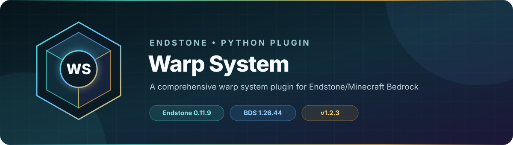

<!-- endstone-professional-header:start -->
<p align="center">
  
</p>

<p align="center">
  <a href="https://github.com/TheNINJALLO/endstone-warp-system/actions/workflows/wheel-release.yml"></a>
  <a href="https://github.com/TheNINJALLO/endstone-warp-system/releases/latest"></a>
</p>

<p align="center">
  
  
  
  =3.11" src="https://img.shields.io/badge/Python-%3E=3.11-3776AB?style=flat-square&amp;logo=python&amp;logoColor=white">
</p>

<p align="center">
  <strong>A comprehensive warp system plugin for Endstone/Minecraft Bedrock.</strong>
</p>

<p align="center">
  <a href="#what-it-does">What it does</a> &bull;
  <a href="#how-to-use">How to use</a> &bull;
  <a href="#commands-and-permissions">Commands</a> &bull;
  <a href="#install">Install</a> &bull;
  <a href="https://github.com/TheNINJALLO/endstone-warp-system/releases">Releases</a>
</p>

## Overview

A comprehensive warp system plugin for Endstone/Minecraft Bedrock. This release is aligned with Endstone 0.11.14 and Minecraft Bedrock Dedicated Server 1.26.52.3, and is distributed as a Python wheel for direct installation in an Endstone server.

## What it does

- Provides form-based personal warps with tiered slot counts and persistent JSON storage.
- Includes fixed public destinations, per-player edit/delete cooldowns, and administrator browsing/reset tools.
- Opens from configured custom rope items rather than a slash command.

## How to use

1. Grant one of `warp.warp1`, `warp.warp2`, or `warp.warp3` and provide the matching `ninjos:rope1`, `ninjos:rope2`, or `ninjos:rope3` item.
2. The player uses the rope item, chooses **Add New Warp**, and saves a name, dimension, and coordinates.
3. Open the same item again to teleport, edit, or delete; normal edits/deletes use the configured cooldown.
4. Grant `warp.admin` or `warp.owner` only to staff who need unlimited slots, cooldown reset, or all-player warp browsing.

## Commands and permissions

This plugin registers no slash commands. Players open the warp UI by using the configured rope item while holding the matching `warp.warp1`, `warp.warp2`, or `warp.warp3` permission.

## Compatibility

| Component | Supported version |
|---|---|
| Endstone | `0.11.14` |
| Endstone API | `0.11` |
| Bedrock Dedicated Server | `1.26.52.3` |
| Python | `>=3.11` |
| Plugin release | `v1.2.4` |

## Install

Download the wheel from the matching GitHub release:

```bash
gh release download v1.2.4 --repo TheNINJALLO/endstone-warp-system --pattern "*.whl"
```

Copy the downloaded wheel into the server's `plugins/` directory, remove any older wheel for the same plugin, and restart Endstone.

> [!IMPORTANT]
> Use Endstone `0.11.14` with BDS `1.26.52.3`. Back up worlds and plugin data before upgrading a production server.

## Configuration and secrets

Runtime databases, logs, local `.env` files, server directories, and root `config.toml` files are excluded from source releases. When an example configuration is provided, copy it locally and keep live tokens, passwords, webhook URLs, and server identifiers out of Git.

## Release automation

Every `v*` tag runs [the wheel release workflow](.github/workflows/wheel-release.yml), builds the package in a clean GitHub runner, stores the wheel as a workflow artifact, and attaches it to the matching GitHub release.
<!-- endstone-professional-header:end -->

---

## Project guide

A complete warp system plugin for Endstone/Minecraft Bedrock Edition, ported from JavaScript to Python.

## Features

- **Custom Player Warps**: Players can create, edit, and delete their own warp points
- **Tiered System**: Different permission levels grant different numbers of warp slots (3, 5, or 8)
- **Fixed Warps**: Spawn and Shopping District warps available to all players
- **Edit Cooldown**: 6-hour cooldown on warp edits/deletions (bypassed by admins)
- **Admin Tools**: 
  - View all players' warps
  - Manage player cooldowns
  - Unlimited warp slots
- **Item-Based Access**: Use special items (rope1, rope2, rope3) to open the warp menu

## Directory Structure

```
warp-system/
├── pyproject.toml
├── README.md
├── src/
│   └── warp_system/
│       ├── __init__.py
│       ├── plugin.py
│       └── plugin.yml
└── data/
    ├── warps.json
    └── cooldowns.json
```

## Installation

1. **Create the directory structure:**

```bash
mkdir -p warp-system/src/warp_system
cd warp-system
```

2. **Create the files:**

- Place `pyproject.toml` in the root directory
- Place the plugin code in `src/warp_system/plugin.py`
- Create `src/warp_system/__init__.py` (can be empty)
- Create `src/warp_system/plugin.yml`

3. **Create `src/warp_system/__init__.py`:**

```python
from .plugin import WarpSystemPlugin

__all__ = ['WarpSystemPlugin']
```

4. **Create `src/warp_system/plugin.yml`:**

```yaml
name: WarpSystem
version: 1.0.0
api-version: "0.5"
main: warp_system.plugin.WarpSystemPlugin
description: A comprehensive warp system for Endstone
author: YourName
website: https://example.com

permissions:
  warp.warp1:
    description: Allows 3 custom warps
    default: false
  warp.warp2:
    description: Allows 5 custom warps
    default: false
  warp.warp3:
    description: Allows 8 custom warps
    default: false
  warp.admin:
    description: Admin access with unlimited warps
    default: op
  warp.owner:
    description: Owner access with all privileges
    default: op
```

5. **Build the plugin:**

```bash
pip install build
python -m build
```

6. **Install to Endstone:**

```bash
# Copy the wheel file to your Endstone plugins directory
cp dist/*.whl /path/to/endstone/plugins/
```

Or install directly:

```bash
pip install dist/warp_system-1.0.0-py3-none-any.whl
```

## Configuration

### Permissions

Grant permissions to players or groups:

- `warp.warp1` - 3 custom warp slots
- `warp.warp2` - 5 custom warp slots
- `warp.warp3` - 8 custom warp slots
- `warp.admin` - Unlimited warps, no cooldowns, admin tools
- `warp.owner` - Same as admin with full privileges

### Items

The plugin responds to these items (configurable in the code):

- `ninjos:rope1` - Requires `warp.warp1` permission
- `ninjos:rope2` - Requires `warp.warp2` permission
- `ninjos:rope3` - Requires `warp.warp3` permission

### Data Storage

The plugin stores data in JSON files:

- `plugins/warp_system/warps.json` - Player warp locations
- `plugins/warp_system/cooldowns.json` - Edit cooldown timestamps

## Usage

1. **Open Warp Menu:**
   - Use one of the warp items (rope1, rope2, or rope3)
   - Must have the corresponding permission

2. **Create a Warp:**
   - Click "Add New Warp (+)" in the main menu
   - Enter a name (max 15 characters)
   - Select dimension (Overworld, Nether, End)
   - Enter coordinates or leave blank to use current position

3. **Use a Warp:**
   - Click on any warp in the main menu
   - Click "Teleport" to go to that location

4. **Edit a Warp:**
   - Select a warp from the main menu
   - Click "Edit"
   - Modify name, dimension, or coordinates
   - Subject to 6-hour cooldown (unless admin)

5. **Delete a Warp:**
   - Select a warp from the main menu
   - Click "Delete"
   - Subject to 6-hour cooldown (unless admin)

## Admin Features

### Manage Cooldowns
- Click "Manage Player Cooldowns" in main menu
- Enter player name to reset their edit cooldown

### View All Warps
- Click "View All Players' Warps"
- Browse and teleport to any player's warps

## Cooldown System

- Regular players can only edit/delete warps once every **6 hours**
- Admins bypass this cooldown completely
- Cooldown applies per player, not per warp
- Cooldown can be reset by Owner/Admin

## Fixed Warp Locations

You can modify these in the plugin code:

- **Spawn**: x: 438, y: 97, z: 757 (Overworld)
- **Shopping District**: x: 411, y: 64, z: 184 (Overworld)

## Troubleshooting

### Plugin won't load
- Ensure Endstone version is 0.11.9 or higher
- Check that `plugin.yml` is properly formatted
- Verify the directory structure matches the layout above

### Forms not showing
- Ensure the player has the required permissions
- Check that the player is using the correct item
- Review server logs for error messages

### Warps not saving
- Check file permissions on the `data/` directory
- Ensure the plugin has write access
- Review logs for save errors

### Teleport failures
- Verify coordinates are valid integers
- Ensure the target dimension exists
- Check that the location is safe (not in a wall, etc.)

## Development

### Modifying Fixed Warps

Edit the coordinates in `plugin.py`:

```python
def handle_main_menu_selection(self, player: Player, selection: int, visible_warps: List[Dict]) -> None:
    # ...
    if selection == 0:
        # Change Spawn coordinates here
        self.teleport_to_location(player, 438, 97, 757, "overworld")
    elif selection == 1:
        # Change Shopping District coordinates here
        self.teleport_to_location(player, 411, 64, 184, "overworld")
```

### Changing Warp Slots

Modify the permission check logic in `get_player_warp_data()`:

```python
def get_player_warp_data(self, player: Player) -> Dict[str, Any]:
    # ...
    max_custom = 0
    if self.has_tag(player, "WARP1"):
        max_custom = 3  # Change this value
    if self.has_tag(player, "WARP2"):
        max_custom = 5  # Change this value
    if self.has_tag(player, "WARP3"):
        max_custom = 8  # Change this value
```

### Adjusting Cooldown Duration

Change the cooldown time in milliseconds (default: 6 hours):

```python
# In show_warp_options method
cooldown_remaining = (6 * 60 * 60 * 1000) - (int(time.time() * 1000) - last_edit)
#                      ^ hours ^ minutes ^ seconds ^ milliseconds
```

### Adding New Fixed Warps

1. Add a new button in `show_main_menu()`:
```python
form.button("My New Warp\n§8Description here", "textures/items/compass")
```

2. Handle the selection in `handle_main_menu_selection()`:
```python
elif selection == 2:  # Adjust index based on position
    self.teleport_to_location(player, x, y, z, "overworld")
```

3. Update `base_buttons` variable to account for the new button

## API Reference

### Main Methods

#### `show_main_menu(player: Player) -> None`
Displays the main warp interface to the player.

#### `teleport_to_location(player: Player, x: int, y: int, z: int, dimension_id: str) -> None`
Teleports a player to the specified coordinates and dimension.

#### `get_player_warp_data(player: Player) -> Dict[str, Any]`
Returns player's warp data including custom warps and max slot count.

#### `has_tag(player: Player, tag: str) -> bool`
Checks if player has a specific permission/tag.

### Data Structure

#### Warp Object
```python
{
    "name": "My Warp",
    "coords": [100, 64, 200],
    "dimension": "overworld"
}
```

#### Player Data
```python
{
    "customWarps": [
        # Array of warp objects
    ]
}
```

#### Cooldown Data
```python
{
    "lastEdit": 1234567890000  # Unix timestamp in milliseconds
}
```

## Migration Notes

### Differences from JavaScript Version

1. **Database Storage**: 
   - JS version used a custom `Database` class
   - Python version uses JSON files directly

2. **Event System**:
   - JS: `world.afterEvents.itemUse.subscribe()`
   - Python: `@event_handler` decorator with `PlayerInteractEvent`

3. **Permissions**:
   - JS: Used tags (`player.hasTag()`)
   - Python: Uses permissions (`player.has_permission()`)

4. **Forms**:
   - JS: `ActionFormData` and `ModalFormData` classes
   - Python: `ActionForm` and `ModalForm` with callbacks

5. **Time Handling**:
   - JS: `Date.now()`
   - Python: `time.time() * 1000`

## Known Limitations

1. **Item Detection**: The `PlayerInteractEvent` may need adjustment depending on how Endstone handles item usage events in version 0.11

2. **Dimension Names**: The plugin assumes dimension IDs are "overworld", "nether", and "the_end". Verify these match your server's dimension naming.

3. **Form UI**: Form appearance depends on Bedrock Edition's UI implementation and may vary slightly from the JavaScript version.

## Contributing

To contribute to this plugin:

1. Fork the repository
2. Create a feature branch
3. Make your changes
4. Test thoroughly on an Endstone server
5. Submit a pull request

## License

MIT License - See LICENSE file for details

## Support

For issues, questions, or feature requests:
- Check the [Endstone documentation](https://endstone.dev/latest/)
- Review server logs for error messages
- Submit an issue on the project repository

## Changelog

### Version 1.0.0
- Initial release
- Complete port from JavaScript to Python/Endstone
- Support for custom player warps
- Tiered permission system
- Admin management tools
- Edit cooldown system
- Fixed spawn and shopping district warps
